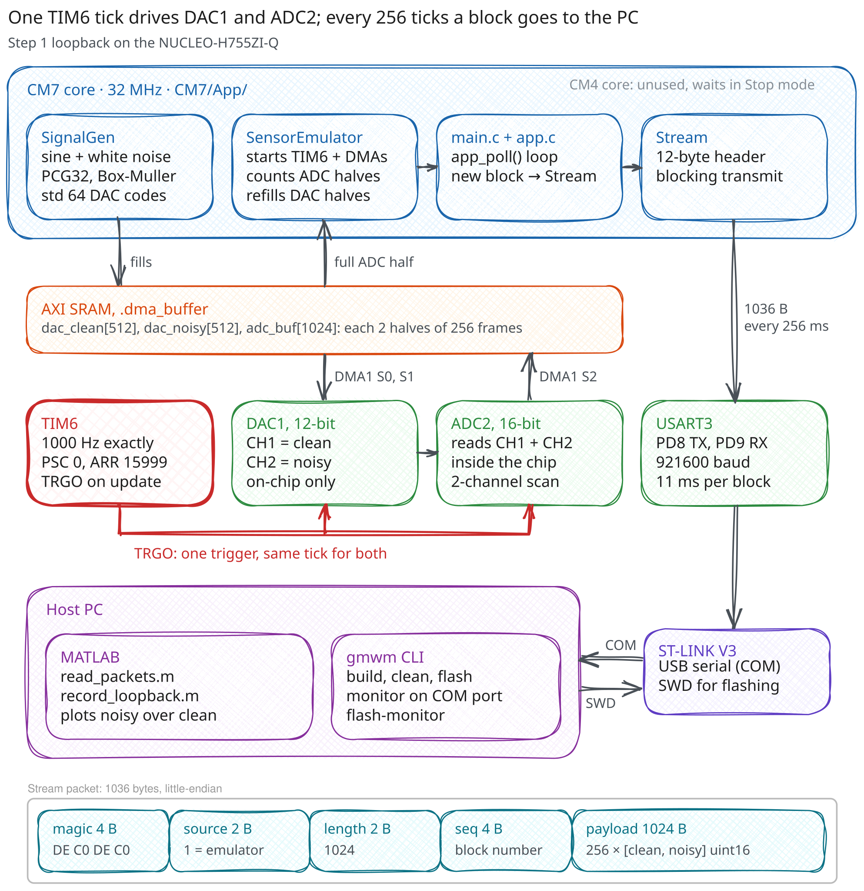

# GMWM IMU Calibration

Use the Generalized Method of Wavelet Moments (GMWM) to identify an IMU's stochastic error model from real data. Then turn that model into the noise parameters of a Kalman filter, for rocket thrust vector control.

Hardware: NUCLEO-H755ZI-Q (STM32H755) and an IMU (BNO086). Firmware in C using ST's eco system, analysis in MATLAB.

## Status

Step 1, the loopback reference, works end to end. The board makes a clean 1 Hz sine and the same sine with white Gaussian noise of a known size, reads both back with its ADC, and streams them to the PC. A 10 s recording measures the noise at 1012 to 1023 ADC codes, against the 1024 injected. Step 2 is next.



TIM6 ticks at 1 kHz and triggers both DAC channels and an ADC2 scan of both on the same tick, all inside the chip. Every 256 ticks the CM7 sends one 1036-byte packet over USART3, and the ST-LINK passes it to the PC as a virtual COM port. The diagram is an Excalidraw file: open it in Excalidraw to edit it.

## Steps

1. **Loopback reference** (done). The DAC generates a clean signal and the same signal with known noise added. The ADC samples both, and the data is streamed to MATLAB.
2. **GMWM on known noise** (next). Compute the wavelet variance and fit a GMWM model to the loopback data. Check that it recovers the noise that was injected.
3. **Real IMU data.** Record long, static IMU logs and fit GMWM models to the gyro and accelerometer.
4. **Kalman calibration.** Turn the fitted model into Kalman filter noise parameters and test the filter.
5. **Compare.** Compare IMUs and calibration methods, such as GMWM against the Allan variance.

## Repository layout

```text
.
├── firmware/
│   └── GMWM-IMU-Calibration/         STM32CubeMX dual-core CMake project
│       ├── GMWM-IMU-Calibration.ioc  peripheral setup
│       ├── CM7/
│       │   └── App/                  hand-written firmware
│       │       ├── SignalGen/
│       │       ├── SensorEmulator/
│       │       ├── Stream/
│       │       └── app_config.h      experiment settings
│       └── CM4/                      second core, unused; waits in Stop mode
├── matlab/
│   ├── read_packets.m                reads the stream
│   └── record_loopback.m             records and plots step 1
├── tools/
│   └── gmwm/                         Python CLI to build, flash, and monitor the board
├── assets/
└── .githooks/
```

## Getting started

You need:

- Arm GNU Toolchain (`arm-none-eabi-gcc`; 14.2 is used here), CMake 3.22 or newer, and Ninja
- STM32CubeProgrammer, to flash through the board's ST-LINK
- Python 3.10 or newer
- MATLAB R2019b or newer, for `serialport`
- clang-format 21 or newer, for the pre-commit hook

Once per clone:

```sh
pip install -e .                       # installs the gmwm CLI and pyserial
git config core.hooksPath .githooks    # turns on the format check
```

Build, flash, and watch the stream:

```sh
python -m gmwm flash-monitor
```

| Command | What it does |
| --- | --- |
| `python -m gmwm build` | Builds both cores with the `Debug` preset |
| `python -m gmwm clean` | Deletes the build folders |
| `python -m gmwm flash` | Builds, then flashes and verifies both cores over SWD |
| `python -m gmwm monitor` | Prints one line per streamed block: clean range, noise mean and std (`-p` port, `-b` baud) |
| `python -m gmwm flash-monitor` | `flash`, then `monitor` |

To record in MATLAB, stop the monitor first, since the COM port has one owner at a time. Set `port` in `matlab/record_loopback.m` and run it.

The experiment settings (sample rate, signal, noise level, seed) are in `firmware/GMWM-IMU-Calibration/CM7/App/app_config.h`. Change them, then flash again.

## Code style

`.clang-format` applies to `CM7/App/` only, so the CubeMX code stays as generated. With the hook on, a commit that stages unformatted files there is rejected, and the hook prints the command that fixes them. If clang-format is not on your PATH, point the hook at it with `git config hooks.clangFormat <path-to-clang-format>`.
