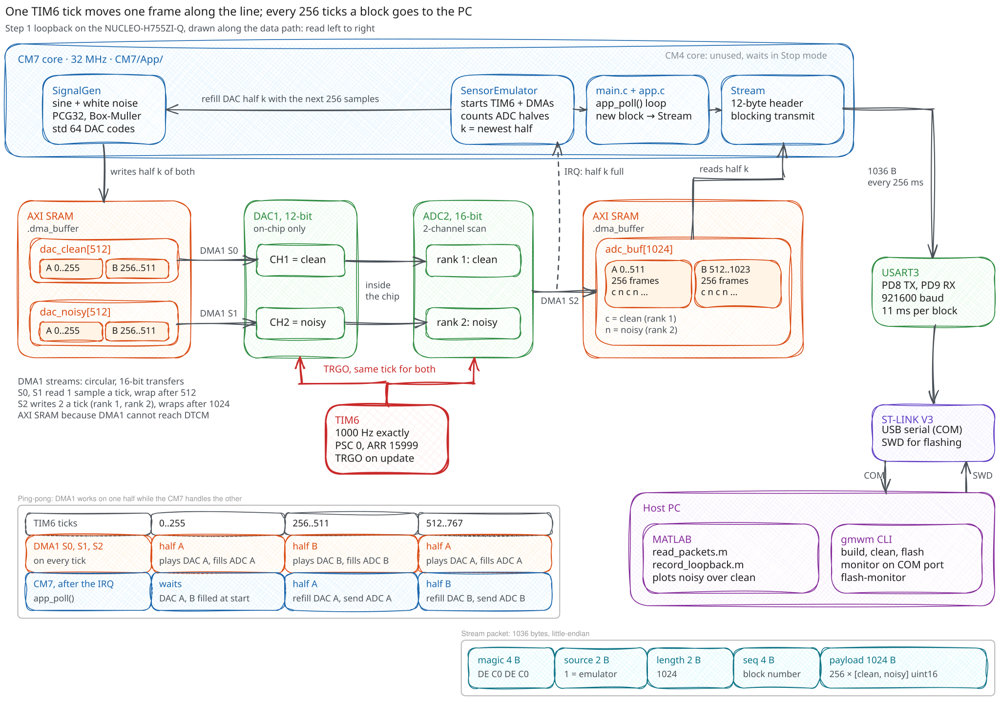

# GMWM IMU Calibration

Use the Generalized Method of Wavelet Moments (GMWM) to identify an IMU's stochastic error model from real data. Then turn that model into the noise parameters of a Kalman filter.

Hardware: a NUCLEO-H755ZI-Q (STM32H755) for the step 1 warm-up, then a Seeed Studio XIAO nRF52840 Sense and its LSM6DS3TR-C 6-axis IMU. Firmware in C, analysis in MATLAB.

## Status

Step 1 is done. The board emulates a static MEMS IMU, and from one 19 min recording GMWM recovers the white noise within 0.2% and both Gauss-Markov standard deviations within 5%. The correlation times (14% and 45% low) and the random walk (29% low) are within the normal spread for one recording this long, so the real IMU will need longer or repeated logs.

Step 2 is in progress. The XIAO streams the LSM6DS3TR-C's raw gyro, accelerometer, and temperature, and `python -m gmwm record` saves the stream for MATLAB.



TIM6 ticks at 1 kHz and triggers both DAC channels and an ADC2 scan of both on the same tick, all inside the chip. Every 256 ticks the CM7 sends one 1036-byte packet over USART3, and the ST-LINK passes it to the PC as a virtual COM port. The diagram is an Excalidraw file: open it in Excalidraw to edit it.

## Steps

1. **Emulated IMU** (done). The DAC generates a constant level and the same level with a known IMU noise model added: white noise, two Gauss-Markov processes, and a random walk, at the levels of an LSM6DS3TR-C gyro. The ADC samples both and streams them to MATLAB, where GMWM has to recover the model.
2. **Stream the IMU** (in progress). Firmware for the XIAO that reads the LSM6DS3TR-C's raw gyro, accelerometer, and temperature and streams them to the PC over USB.
3. **Real IMU data.** Record long, static IMU logs and fit GMWM models to the gyro and accelerometer.
4. **Kalman calibration.** Turn the fitted model into Kalman filter noise parameters and test the filter.
5. **Compare.** Compare IMUs and calibration methods, such as GMWM against the Allan variance.

## Repository layout

```text
.
├── firmware/                         by purpose, then by board
│   ├── common/
│   │   └── stream/                   packet format to the PC, shared by every board
│   ├── imu-emulator/                 step 1: emulates an IMU with a known noise model
│   │   └── nucleo-h755zi-q/          STM32CubeMX dual-core CMake project
│   │       ├── GMWM-IMU-Calibration.ioc  peripheral setup
│   │       ├── CM7/
│   │       │   └── App/              hand-written firmware
│   │       │       ├── SignalGen/
│   │       │       │   └── signal_gen_config.h  experiment settings
│   │       │       ├── SensorEmulator/
│   │       │       └── Stream/       sends stream packets over USART3
│   │       └── CM4/                  second core, unused; waits in Stop mode
│   └── imu-streamer/                 step 2: streams a real IMU
│       └── xiao-nrf52840-sense/      Zephyr application (nRF Connect SDK)
│           ├── CMakeLists.txt
│           ├── prj.conf              Kconfig options
│           ├── app.overlay           devicetree: a larger USB TX buffer
│           ├── include/
│           │   ├── app_config.h      acquisition settings
│           │   └── Imu/              LSM6DS3TR-C registers; the stream payload
│           └── src/
│               ├── Imu/              LSM6DS3TR-C over i2c0; FIFO to sample blocks
│               ├── Stream/           sends stream packets over USB CDC ACM
│               └── main.c
├── matlab/
│   ├── wavelets/                     Haar wavelet variance, model wavelet variances, GMWM fit
│   ├── read_packets.m                reads the stream
│   ├── emulated_imu.m                fits GMWM to the emulated IMU: recorded or simulated
│   ├── read_imu_log.m                reads an IMU log from gmwm record
│   └── view_imu_log.m                plots an IMU log and its wavelet variance
├── data/                             recordings
├── tools/
│   └── gmwm/                         Python CLI: build and flash the Nucleo; monitor and record either board
├── assets/
└── .githooks/
```

## Getting started

You need:

- Arm GNU Toolchain (`arm-none-eabi-gcc`; 14.2 is used here), CMake 3.22 or newer, and Ninja
- STM32CubeProgrammer, to flash through the board's ST-LINK
- nRF Connect SDK v3.2.1 and its toolchain, for the XIAO. The nRF Connect for VS Code extension installs both (to `C:/ncs` by default), and it works in Cursor too
- Python 3.10 or newer
- MATLAB R2019b or newer, for `serialport`
- clang-format 21 or newer, for the pre-commit hook

Once per clone:

```sh
pip install -e .                       # installs the gmwm CLI and pyserial
git config core.hooksPath .githooks    # turns on the format check
```

### Emulator: NUCLEO-H755ZI-Q

Build, flash, and watch the stream:

```sh
python -m gmwm flash-monitor
```

| Command | What it does |
| --- | --- |
| `python -m gmwm build` | Builds both cores with the `Debug` preset |
| `python -m gmwm clean` | Deletes the build folders |
| `python -m gmwm flash` | Builds, then flashes and verifies both cores over SWD |
| `python -m gmwm monitor` | Prints one line per streamed block: clean range, noise mean and std (`-p` port, `-b` baud). Works for the XIAO too |
| `python -m gmwm flash-monitor` | `flash`, then `monitor` |

### IMU streamer: XIAO nRF52840 Sense

Run these in a terminal with the nRF Connect SDK v3.2.1 toolchain on its PATH, such as the **nRF Connect** terminal profile that the extension adds to the editor's terminal menu. From `firmware/imu-streamer/xiao-nrf52840-sense/`:

```sh
west build -b xiao_ble/nrf52840/sense -d C:/gmwm-build/xiao-nrf52840-sense   # build
west flash -d C:/gmwm-build/xiao-nrf52840-sense -r uf2                       # flash
```

The build goes to `C:/gmwm-build/`, outside the repo. On Windows, Zephyr's build tree is so deep that a build folder inside the repo makes object paths longer than the 260-character limit. `CMakeLists.txt` stops with this command in its message if the build folder's path is longer than 90 characters. In the nRF Connect panel, set the build configuration's build directory to the same folder.

To flash, double-press the XIAO's reset button first. The bootloader then shows up as a USB drive (`XIAO-SENSE`), and `west flash` copies `zephyr.uf2` onto it.

The board shows up as a USB serial port with USB ID `2fe3:0004`. The baud rate doesn't matter.

#### What it streams

The IMU's own clock paces the samples. The LSM6DS3TR-C writes each gyro and accelerometer sample to its 4 KB FIFO, and the firmware drains the FIFO over I2C every 10 ms. Each block of 32 samples goes out as one stream packet (source `STREAM_SRC_LSM6DS3TRC`) with the IMU's temperature. A slow poll or a slow PC delays samples but doesn't lose them. If samples are lost anyway, because the FIFO overflowed, an I2C read failed, or USB dropped bytes, a block number is missing, so the PC sees the gap.

Every packet also carries the IMU's `CTRL1_XL` and `CTRL2_G` register values, so the PC reads the sample rate and full scales from the data itself. The settings are in `firmware/imu-streamer/xiao-nrf52840-sense/include/app_config.h`:

| Setting | Default | |
| --- | --- | --- |
| `IMU_ODR` | 104 Hz | gyro, accelerometer, and FIFO rate, 12.5 Hz to 1.66 kHz |
| `IMU_GYRO_FS` | ±125 dps | 4.375 mdps per code, the finest |
| `IMU_ACCEL_FS` | ±2 g | 0.061 mg per code, the finest |
| `IMU_FRAMES_PER_BLOCK` | 32 | samples per packet |

The red LED toggles with every packet. If it stays on, the IMU could not be set up, and the firmware prints why to the USB port once a second.

#### Record

Watch the stream:

```sh
python -m gmwm monitor          # one line per block: mean gyro [dps], mean accel [g], temperature
```

Record a log, here for 3 hours:

```sh
python -m gmwm record data/imu_static_01.bin -t 3h
```

`-t` takes values like `3h`, `90m`, or `1h30m`. Leave it out to record until Ctrl+C. The recorder writes each packet as it arrives, so a crash keeps everything before it. It keeps Windows awake while recording, prints progress every 10 s, and reports every gap. At the end it times the IMU's sample rate against the PC clock.

For GMWM, keep the board still and keep its temperature steady. Reset it just before recording, since the gyro bias settles after power-up. Close the monitor first, since the COM port has one owner.

Then, in MATLAB from `matlab/`:

```matlab
imu = read_imu_log("../data/imu_static_01.bin");   % gyro [dps], accel [g], temp [degC], fs, lost
imu = read_imu_log("../data/imu_static_01.bin", [2.8 9.5] * 3600);   % only 2.8 h to 9.5 h into the log
```

The optional window keeps one part of the log, in seconds since its first sample. Use it to drop the warm-up and any stretch with vibration or a temperature ramp, because both bias the wavelet variance. The log itself stays as recorded.

`view_imu_log.m` plots a log against time, plus each axis's Haar wavelet variance. Set `window` at its top. Check that `imu.lost` is 0 before you fit: `gyro` and `accel` run straight across any gaps.

## Run GMWM

Run `matlab/emulated_imu.m` from `matlab/`. Set `source` at the top:

| `source` | Data | Needs |
| --- | --- | --- |
| `"recording"` | the board recording in `data/emulated_imu.mat` | MATLAB |
| `"sim"` | the same noise, simulated in MATLAB | MATLAB |
| `"board"` | a new 19 min recording from your board, saved to `file` | the board, flashed |

For `"board"`, set `file` to a new name and stop the monitor (the COM port has one owner). Reset the board just before, since the random walk grows from reset, and keep the PC awake, since sleep cuts the stream.

The experiment settings (sample rate, signal, noise processes, seed) are in `firmware/imu-emulator/nucleo-h755zi-q/CM7/App/SignalGen/signal_gen_config.h`. Change them, then flash again.

## Code style

`.clang-format` applies to the hand-written code only (`CM7/App/`, `firmware/common/`, and the XIAO's `src/` and `include/`), so the CubeMX code stays as generated. With the hook on, a commit that stages unformatted files there is rejected, and the hook prints the command that fixes them. If clang-format is not on your PATH, point the hook at it with `git config hooks.clangFormat <path-to-clang-format>`.
