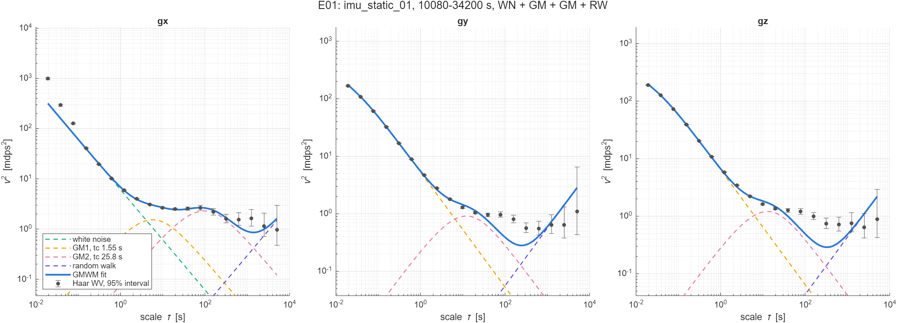

# Results

Generated by `python experiments/run.py --report` from each experiment's `out/`; do not edit by hand.
How the experiments run, and the units: [experiments/README.md](experiments/README.md).

## imu_static_01, 2.8 to 9.5 h: gyro

| Axis | Term | Parameter | Unit | [E01](experiments/E01-imu01-haar-gmwm/) GMWM, Haar (this repo) (draft) |
| --- | --- | --- | --- | ---: |
| x | WN | density | mdps/sqrt(Hz) | 3.5 |
| x | GM1 | tc | s | 1.55 |
| x | GM1 | std | mdps | 2.83 |
| x | GM2 | tc | s | 25.8 |
| x | GM2 | std | mdps | 3.47 |
| x | RW | K | mdps/sqrt(s) | 0.0596 |
| y | WN | density | mdps/sqrt(Hz) | 1.2e-05 |
| y | GM1 | tc | s | 0.00508 |
| y | GM1 | std | mdps | 20.3 |
| y | GM2 | tc | s | 3.25 |
| y | GM2 | std | mdps | 2.19 |
| y | RW | K | mdps/sqrt(s) | 0.0821 |
| z | WN | density | mdps/sqrt(Hz) | 3.19e-07 |
| z | GM1 | tc | s | 0.00545 |
| z | GM1 | std | mdps | 21.8 |
| z | GM2 | tc | s | 3.4 |
| z | GM2 | std | mdps | 2.52 |
| z | RW | K | mdps/sqrt(s) | 0.0721 |

| Axis | Fit | [E01](experiments/E01-imu01-haar-gmwm/) |
| --- | --- | ---: |
| x | objective | 1.94e+03 |
| x | scales | 19 |
| x | run time [s] | 14.5 |
| y | objective | 434 |
| y | scales | 19 |
| y | run time [s] | 44.5 |
| z | objective | 572 |
| z | scales | 19 |
| z | run time [s] | 17.6 |

**E01:** `gyro_wv.png`

