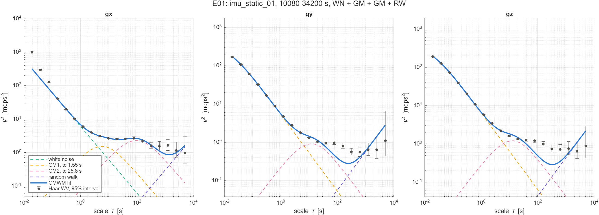

# Results

Generated by `python experiments/run.py --report` from each experiment's `out/`; do not edit by hand.
How the experiments run, and the units: [experiments/README.md](experiments/README.md).

## imu_static_01, 2.8 to 9.5 h: gyro

| Axis | Term | Parameter | Unit | [E01](experiments/E01-imu01-haar-gmwm/) GMWM, Haar (this repo) (draft) | [E02](experiments/E02-imu01-simts-gmwm/) GMWM, simts 0.2.4 (draft) |
| --- | --- | --- | --- | ---: | ---: |
| x | WN | density | mdps/sqrt(Hz) | 3.5 | 4.56 [4.55, 4.57] |
| x | GM1 | tc | s | 1.55 | 27.6 [22.9, 34.6] |
| x | GM1 | std | mdps | 2.83 | 3.69 [3.34, 4.04] |
| x | GM2 | tc | s | 25.8 | 483 [118, inf] |
| x | GM2 | std | mdps | 3.47 | 1.98 [0.0502, 3.91] |
| x | RW | K | mdps/sqrt(s) | 0.0596 | 0.0596 [0, 0.104] |
| y | WN | density | mdps/sqrt(Hz) | 1.2e-05 | 0.609 [0, 0.872] |
| y | GM1 | tc | s | 0.00508 | 0.00547 [0.0053, 0.00563] |
| y | GM1 | std | mdps | 20.3 | 19.6 [19.1, 20.1] |
| y | GM2 | tc | s | 3.25 | 4.24 [3.91, 4.63] |
| y | GM2 | std | mdps | 2.19 | 2.21 [2.15, 2.26] |
| y | RW | K | mdps/sqrt(s) | 0.0821 | 0.069 [0.0514, 0.0829] |
| z | WN | density | mdps/sqrt(Hz) | 3.19e-07 | 0.674 [0.333, 0.892] |
| z | GM1 | tc | s | 0.00545 | 0.00593 [0.00578, 0.00607] |
| z | GM1 | std | mdps | 21.8 | 21.1 [20.7, 21.5] |
| z | GM2 | tc | s | 3.4 | 5.16 [4.75, 5.64] |
| z | GM2 | std | mdps | 2.52 | 2.56 [2.5, 2.63] |
| z | RW | K | mdps/sqrt(s) | 0.0721 | 0.0558 [0.039, 0.0686] |

| Axis | Fit | [E01](experiments/E01-imu01-haar-gmwm/) | [E02](experiments/E02-imu01-simts-gmwm/) |
| --- | --- | ---: | ---: |
| x | objective | 1.94e+03 | 1.3e+04 |
| x | scales | 19 | 21 |
| x | run time [s] | 14.5 | 3.7 |
| y | objective | 434 | 17.1 |
| y | scales | 19 | 21 |
| y | run time [s] | 44.5 | 3.75 |
| z | objective | 572 | 26.3 |
| z | scales | 19 | 21 |
| z | run time [s] | 17.6 | 3.77 |

**E01:** `gyro_wv.png`

**E02:** `gyro_wv.png`

