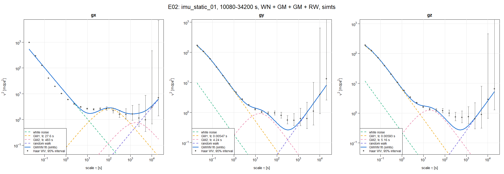
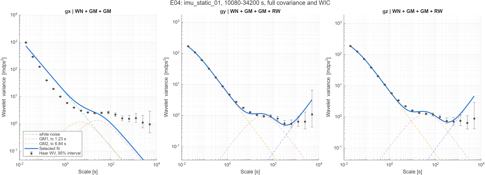
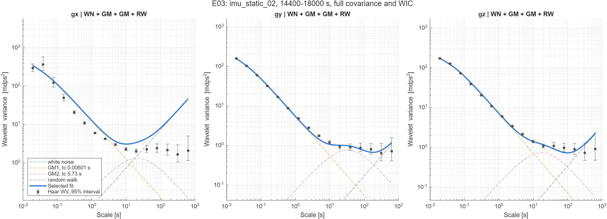
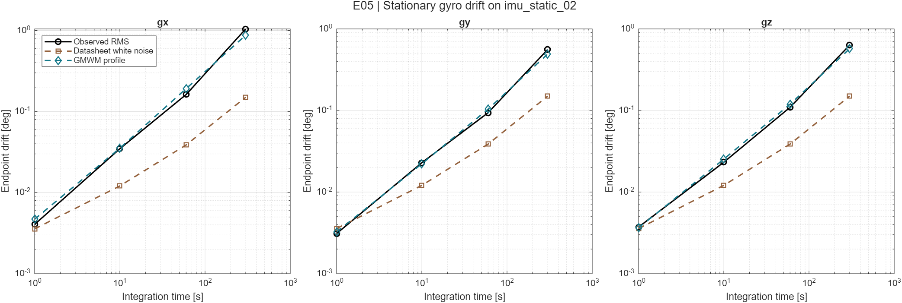
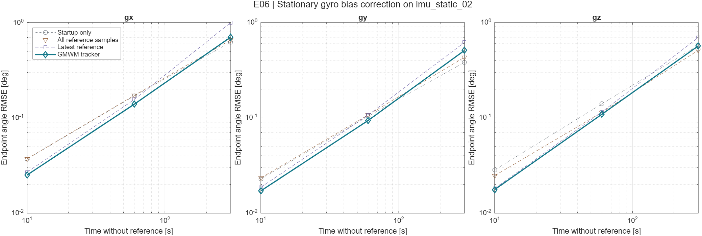
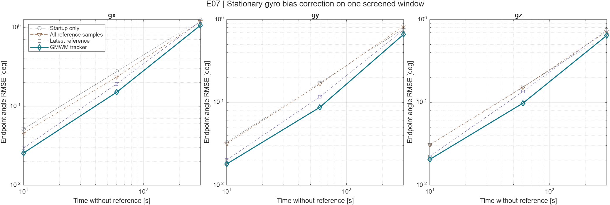

# Results

Generated by `python experiments/run.py --report` from each experiment's `out/`; do not edit by hand.
How the experiments run, and the units: [experiments/README.md](experiments/README.md).

## imu_static_01, 2.8 to 9.5 h: gyro

| Axis | Term | Parameter | Unit | [E01](experiments/E01-imu01-haar-gmwm/) GMWM, Haar (this repo) (historical inputs) | [E02](experiments/E02-imu01-simts-gmwm/) GMWM, simts 0.2.4 (draft) | [E04](experiments/E04-imu01-full-gmwm/) GMWM, Haar with full covariance and WIC (draft) |
| --- | --- | --- | --- | ---: | ---: | ---: |
| x | WN | density | mdps/sqrt(Hz) | 3.5 | 4.56 [4.55, 4.57] | 5.34 [5.34, 5.34] |
| x | GM1 | tc | s | 1.55 | 27.6 [22.9, 34.6] | 1.23 [0.99, 1.52] |
| x | GM1 | std | mdps | 2.83 | 3.69 [3.34, 4.04] | 2.5 [2.22, 2.81] |
| x | GM2 | tc | s | 25.8 | 483 [118, inf] | 6.84 [4.82, 9.71] |
| x | GM2 | std | mdps | 3.47 | 1.98 [0.0502, 3.91] | 2.67 [2.44, 2.92] |
| x | RW | K | mdps/sqrt(s) | 0.0596 | 0.0596 [0, 0.104] |  |
| y | WN | density | mdps/sqrt(Hz) | 1.2e-05 | 0.609 [0, 0.872] | 0 |
| y | GM1 | tc | s | 0.00508 | 0.00547 [0.0053, 0.00563] | 0.0054 [0.00538, 0.00542] |
| y | GM1 | std | mdps | 20.3 | 19.6 [19.1, 20.1] | 20.1 [20.1, 20.2] |
| y | GM2 | tc | s | 3.25 | 4.24 [3.91, 4.63] | 9.65 [8.99, 10.4] |
| y | GM2 | std | mdps | 2.19 | 2.21 [2.15, 2.26] | 2.27 [2.22, 2.32] |
| y | RW | K | mdps/sqrt(s) | 0.0821 | 0.069 [0.0514, 0.0829] | 0.0877 [0.0758, 0.102] |
| z | WN | density | mdps/sqrt(Hz) | 3.19e-07 | 0.674 [0.333, 0.892] | 0 |
| z | GM1 | tc | s | 0.00545 | 0.00593 [0.00578, 0.00607] | 0.00585 [0.00582, 0.00587] |
| z | GM1 | std | mdps | 21.8 | 21.1 [20.7, 21.5] | 21.7 [21.7, 21.7] |
| z | GM2 | tc | s | 3.4 | 5.16 [4.75, 5.64] | 9.69 [9.06, 10.4] |
| z | GM2 | std | mdps | 2.52 | 2.56 [2.5, 2.63] | 2.59 [2.53, 2.65] |
| z | RW | K | mdps/sqrt(s) | 0.0721 | 0.0558 [0.039, 0.0686] | 0.105 [0.0963, 0.116] |

| Axis | Fit | [E01](experiments/E01-imu01-haar-gmwm/) | [E02](experiments/E02-imu01-simts-gmwm/) | [E04](experiments/E04-imu01-full-gmwm/) |
| --- | --- | ---: | ---: | ---: |
| x | objective | 1.94e+03 | 1.3e+04 | 1.45e+06 |
| x | scales | 19 | 21 | 19 |
| x | run time [s] | 14.5 | 3.7 | 170 |
| y | objective | 434 | 17.1 | 850 |
| y | scales | 19 | 21 | 19 |
| y | run time [s] | 44.5 | 3.75 | 153 |
| z | objective | 572 | 26.3 | 1.57e+03 |
| z | scales | 19 | 21 | 19 |
| z | run time [s] | 17.6 | 3.77 | 152 |

**E01:** `gyro_wv.png`

**E02:** `gyro_wv.png`

**E04 WIC rankings**

| Axis | Selected model | WIC | Runner-up | ΔWIC | Monte Carlo SE of Δ |
| --- | --- | ---: | --- | ---: | ---: |
| x | WN + GM + GM | 1.45e+06 | WN + GM + GM + RW | 1.86 | 0.219 |
| y | WN + GM + GM + RW | 861 | WN + GM + GM | 36.6 | 0.177 |
| z | WN + GM + GM + RW | 1.58e+03 | WN + GM + GM | 107 | 0.191 |

**E04:** `gyro_wv.png`

## imu_static_02, 4 to 5 h: gyro

| Axis | Term | Parameter | Unit | [E03](experiments/E03-imu02-full-gmwm/) GMWM, Haar with full covariance and WIC (draft) |
| --- | --- | --- | --- | ---: |
| x | WN | density | mdps/sqrt(Hz) | 0 |
| x | GM1 | tc | s | 0.00601 [0.00597, 0.00606] |
| x | GM1 | std | mdps | 29.5 [29.4, 29.5] |
| x | GM2 | tc | s | 5.73 [4.14, 7.93] |
| x | GM2 | std | mdps | 2.63 [2.38, 2.92] |
| x | RW | K | mdps/sqrt(s) | 0.94 [0.924, 0.956] |
| y | WN | density | mdps/sqrt(Hz) | 0 |
| y | GM1 | tc | s | 0.00574 [0.00568, 0.00579] |
| y | GM1 | std | mdps | 19.8 [19.8, 19.9] |
| y | GM2 | tc | s | 8.88 [6.9, 11.4] |
| y | GM2 | std | mdps | 2.01 [1.87, 2.15] |
| y | RW | K | mdps/sqrt(s) | 0.142 [0.0951, 0.213] |
| z | WN | density | mdps/sqrt(Hz) | 0 |
| z | GM1 | tc | s | 0.00674 [0.00668, 0.00679] |
| z | GM1 | std | mdps | 21.4 [21.4, 21.5] |
| z | GM2 | tc | s | 4.76 [3.53, 6.42] |
| z | GM2 | std | mdps | 1.97 [1.82, 2.14] |
| z | RW | K | mdps/sqrt(s) | 0.203 [0.167, 0.248] |

| Axis | Fit | [E03](experiments/E03-imu02-full-gmwm/) |
| --- | --- | ---: |
| x | objective | 2.37e+05 |
| x | scales | 16 |
| x | run time [s] | 51 |
| y | objective | 161 |
| y | scales | 16 |
| y | run time [s] | 37 |
| z | objective | 1.11e+03 |
| z | scales | 16 |
| z | run time [s] | 23.7 |

**E03 WIC rankings**

| Axis | Selected model | WIC | Runner-up | ΔWIC | Monte Carlo SE of Δ |
| --- | --- | ---: | --- | ---: | ---: |
| x | WN + GM + GM + RW | 2.37e+05 | WN + GM + RW | 125 | 0.3 |
| y | WN + GM + GM + RW | 172 | WN + GM + GM | 1.07 | 0.217 |
| z | WN + GM + GM + RW | 1.12e+03 | WN + GM + GM | 22.3 | 0.204 |

**E03:** `gyro_wv.png`

## E05 stationary gyro drift on imu_static_02, 4 to 5 h

Both profiles use the same startup bias in each trial. Positive log-score gain favors GMWM.
[Experiment setup](experiments/E05-imu02-gyro-drift/README.md)

| Axis | Horizon [s] | Trials | Observed RMS [°] | Datasheet SD [°] | GMWM SD [°] | Datasheet 95% coverage | GMWM 95% coverage | GMWM log-score gain |
| --- | ---: | ---: | ---: | ---: | ---: | ---: | ---: | ---: |
| x | 1 | 59 | 0.00405 | 0.00356 | 0.00469 | 88% | 95% | -0.00181 |
| y | 1 | 59 | 0.0031 | 0.00356 | 0.00324 | 98% | 97% | 0.0159 |
| z | 1 | 59 | 0.00372 | 0.00356 | 0.00364 | 90% | 90% | 0.00149 |
| x | 10 | 51 | 0.0347 | 0.0121 | 0.0353 | 63% | 96% | 2.58 |
| y | 10 | 51 | 0.0229 | 0.0121 | 0.0222 | 67% | 96% | 0.655 |
| z | 10 | 51 | 0.0232 | 0.0121 | 0.0253 | 76% | 94% | 0.685 |
| x | 60 | 30 | 0.162 | 0.0387 | 0.192 | 47% | 97% | 6.8 |
| y | 60 | 30 | 0.094 | 0.0387 | 0.104 | 57% | 97% | 1.55 |
| z | 60 | 30 | 0.11 | 0.0387 | 0.119 | 47% | 97% | 2.45 |
| x | 300 | 10 | 1.04 | 0.15 | 0.873 | 40% | 90% | 21.8 |
| y | 300 | 10 | 0.559 | 0.15 | 0.492 | 80% | 90% | 5.11 |
| z | 300 | 10 | 0.633 | 0.15 | 0.572 | 50% | 90% | 6.95 |

[Per-trial drift and startup bias](experiments/E05-imu02-gyro-drift/out/drift_trials.csv)

## E06 stationary gyro bias correction on imu_static_02, 6.55 to 7.5 h

Endpoint angle RMSE in degrees. Positive reduction favors GMWM over the lowest-RMSE baseline.
[Experiment setup](experiments/E06-imu02-gyro-bias-correction/README.md)

| Axis | Horizon [s] | Trials | Startup only | All reference samples | Latest reference | GMWM | Reduction vs. best baseline |
| --- | ---: | ---: | ---: | ---: | ---: | ---: | ---: |
| x | 10 | 168 | 0.037 | 0.0372 | 0.0269 | 0.0251 | +6.8% |
| y | 10 | 168 | 0.0228 | 0.0234 | 0.0187 | 0.0171 | +8.3% |
| z | 10 | 168 | 0.0283 | 0.0247 | 0.0181 | 0.0176 | +2.6% |
| x | 60 | 48 | 0.17 | 0.173 | 0.156 | 0.139 | +10.7% |
| y | 60 | 48 | 0.104 | 0.107 | 0.107 | 0.0938 | +9.7% |
| z | 60 | 48 | 0.14 | 0.114 | 0.115 | 0.109 | +4.6% |
| x | 300 | 10 | 0.625 | 0.658 | 1 | 0.706 | -12.9% |
| y | 300 | 10 | 0.383 | 0.432 | 0.619 | 0.51 | -33.2% |
| z | 300 | 10 | 0.576 | 0.512 | 0.697 | 0.568 | -11.0% |

[Per-trial angle errors](experiments/E06-imu02-gyro-bias-correction/out/correction_trials.csv)

## E07 stationary gyro bias correction on imu_static_02, 3.46222 to 5.01667 h

Endpoint angle RMSE in degrees. Positive reduction favors GMWM over the lowest-RMSE baseline.
[Experiment setup](experiments/E07-imu02-long-window-bias-correction/README.md)

| Axis | Horizon [s] | Trials | Startup only | All reference samples | Latest reference | GMWM | Reduction vs. best baseline |
| --- | ---: | ---: | ---: | ---: | ---: | ---: | ---: |
| x | 10 | 276 | 0.0514 | 0.0458 | 0.0295 | 0.0255 | +13.5% |
| y | 10 | 276 | 0.0328 | 0.0317 | 0.0201 | 0.018 | +10.6% |
| z | 10 | 276 | 0.0309 | 0.0307 | 0.0223 | 0.0205 | +8.3% |
| x | 60 | 79 | 0.276 | 0.235 | 0.192 | 0.151 | +21.6% |
| y | 60 | 79 | 0.172 | 0.167 | 0.117 | 0.0872 | +25.3% |
| z | 60 | 79 | 0.153 | 0.152 | 0.135 | 0.0979 | +27.7% |
| x | 300 | 17 | 1.26 | 1.18 | 1.2 | 1.06 | +10.1% |
| y | 300 | 17 | 0.781 | 0.836 | 0.751 | 0.663 | +11.7% |
| z | 300 | 17 | 0.664 | 0.72 | 0.751 | 0.643 | +3.2% |

[Per-trial angle errors](experiments/E07-imu02-long-window-bias-correction/out/correction_trials.csv)

