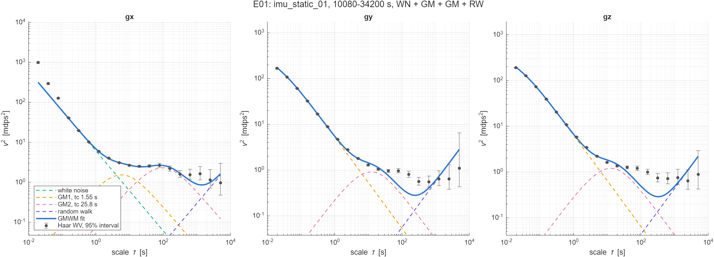

# E01: Haar GMWM from step 1 on the real gyro

**Conclusion:** White noise is 3.3 to 3.6 mdps/sqrt(Hz) on every axis, under the datasheet's typical 5. White noise + 2 Gauss-Markov + random walk leaves gy and gz outside their 95% intervals between about 20 and 500 s.

## Question

Does step 1's GMWM give a sensible noise model for the real LSM6DS3TR-C gyro?

## Setup

| | |
| --- | --- |
| Data | `imu_static_01`, 2.8 h to 9.5 h (the stable window; see [data/README.md](../../data/README.md)), 2,508,480 samples at 104 Hz per axis |
| Model | white noise + 2 Gauss-Markov + random walk, step 1's model |
| Wavelet variance | Haar, 19 dyadic scales from 0.02 s to 5041 s (`matlab/wavelets/haar_wvar.m`) |
| Fit | `gmwm_start` then `gmwm_fit`: each scale weighted by 1 / the variance of its estimate; Nelder-Mead from the 8 best grid starts, keeping the lowest objective; each correlation time under the coarsest scale |
| Intervals | the wavelet variance's 95% intervals are chi-square; the fit gives no parameter intervals |

Run with `python experiments/run.py E01`. Settings in [config.json](config.json), code in [main.m](main.m).

## Results

| Axis | White noise [mdps/sqrt(Hz)] | GM1 tc, std | GM2 tc, std | RW K [mdps/sqrt(s)] | Objective |
| --- | ---: | --- | --- | ---: | ---: |
| x | 3.50 | 1.55 s, 2.83 mdps | 25.8 s, 3.47 mdps | 0.060 | 1945 |
| y | 3.27 (in GM1, see 1.) | 5.1 ms, 20.3 mdps | 3.25 s, 2.19 mdps | 0.082 | 434 |
| z | 3.60 (in GM1, see 1.) | 5.4 ms, 21.8 mdps | 3.40 s, 2.52 mdps | 0.072 | 572 |

All numbers: [RESULTS.md](../../RESULTS.md) and [out/params.csv](out/params.csv).

## Findings

1. **On y and z the white noise sits in a 5 ms Gauss-Markov term**, under one 9.6 ms sample (phi 0.15 and
   0.17), and the white noise parameter itself is about 0. The finest scales are slightly coloured, in line
   with the gyro's digital low-pass filter. A fit that keeps every correlation time at least 2 samples long
   reaches an objective of 2638 or more on z; this fit reaches 572. At scales well above its tc the fast term
   acts as white noise of per-sample variance std² (1 + phi) / (1 - phi), which is the density in the table.
   x has no such term: its finest scales are the 34 Hz tone (4.).
2. **On y and z the fit sits below the data between about 20 and 500 s.** It dips to 0.28 mdps² near 300 s
   while the measured wavelet variance stays at 0.6 to 1.0, outside its 95% interval. The fast term in 1.
   takes one of the two Gauss-Markov terms, so one term covers everything from about a second to an hour.
   The weights favour the fine scales, whose estimates are far more precise, so this gap adds little to the
   objective.
3. **The random walk shows only at the last 2 to 3 scales,** where the intervals span about a factor of 3.
   A 6.7 h window leaves it weakly determined.
4. **gx's three finest scales sit above the fit:** the 34 Hz tone in this log, which the model has no term for.
