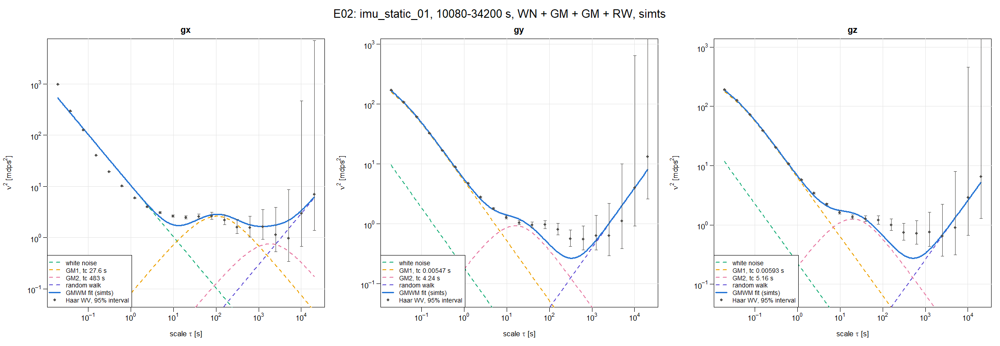

# E02: simts GMWM on the real gyro, with intervals and a fit test

**Conclusion:** simts matches E01's white noise on gy and gz to about 1% (3.30 and 3.64 mdps/sqrt(Hz)), but its weights let gx's 34 Hz tone set gx's (4.56). The J test rejects white noise + 2 Gauss-Markov + random walk on every axis (p ≈ 0), so the model needs another term whichever implementation fits it.

## Question

Does SMAC-Group's GMWM (the R package simts) give the same noise model as E01 on the same data, and how certain are its parameters?

## Setup

| | |
| --- | --- |
| Data | `imu_static_01`, 2.8 h to 9.5 h, 2,508,480 samples at 104 Hz per axis, as in E01 |
| Model | white noise + 2 Gauss-Markov (AR(1) terms in simts) + random walk, as in E01 |
| Code | simts 0.2.4 from the submodule `external/simts` at a716f4d, which `run.py` builds; its internal functions through `simts:::` |
| Wavelet variance | simts's MODWT Haar, 21 dyadic scales from 0.02 s to 20,165 s (E01 stops at 19, 5041 s). 95% intervals are chi-square with max(M / 2^j, 1) degrees of freedom, M the scale's coefficient count |
| Fit | simts's objective with `gmwm()`'s weights, 1 / (interval width)². simts's optimiser from 9 starts: simts's own answer from `gmwm()`, and the 8 best of a grid as in `gmwm_start.m`. Each start is refitted until the objective stops falling; the lowest objective is kept |
| Intervals | V_b, the full covariance of the 21 wavelet variances over 200 series simulated from the fit. Parameter covariance (A'ΩA)⁻¹A'ΩV_bΩA(A'ΩA)⁻¹, A the model's derivative and Ω the fit's weights. 95% Wald intervals, mapped through the transform for density, tc and K; delta method for the Gauss-Markov std |
| Fit test | J test: refit weighted by V_b⁻¹, its objective against chi-square with 21 − 6 = 15 degrees of freedom (95% critical value 25.0) |

Run with `python experiments/run.py E02`; it takes about 10 minutes, mostly the bootstrap. Settings in [config.json](config.json), code in [main.R](main.R). Besides the standard outputs, [out/gof.csv](out/gof.csv) holds the J test and [out/starts.csv](out/starts.csv) the objective from every start.

## Results

| Axis | White noise [mdps/sqrt(Hz)] | GM1 tc, std | GM2 tc, std | RW K [mdps/sqrt(s)] | J statistic |
| --- | ---: | --- | --- | ---: | ---: |
| x | 4.56 [4.555, 4.565] | 27.6 s [22.9, 34.6], 3.69 mdps [3.34, 4.04] | 483 s [118, ∞], 1.98 mdps [0.05, 3.91] | 0.060 [0, 0.104] | 737,106 |
| y | 3.30 (in GM1, see 2.) | 5.47 ms [5.30, 5.63], 19.6 mdps [19.1, 20.1] | 4.24 s [3.91, 4.63], 2.21 mdps [2.15, 2.26] | 0.069 [0.051, 0.083] | 4,120 |
| z | 3.64 (in GM1, see 2.) | 5.93 ms [5.78, 6.07], 21.1 mdps [20.7, 21.5] | 5.16 s [4.75, 5.64], 2.56 mdps [2.50, 2.63] | 0.056 [0.039, 0.069] | 2,715 |

All numbers: [RESULTS.md](../../RESULTS.md) and [out/params.csv](out/params.csv).

## Findings

1. **The J test rejects the model on every axis:** 2,715 to 737,106 against a critical value of 25.0. V_b comes
   from 200 series, and inverting a 21 × 21 covariance estimated that way inflates the statistic by about
   (200 − 1) / (200 − 21 − 2) = 1.12, far too little to change the verdict. The intervals in the table are
   therefore conditional on a model the data reject: they show how tightly that model is pinned, not how far
   the true values may lie. On gy and gz the fit still sits 1.5 to 2.6 times under the data between 80 and
   1000 s, as in E01.
2. **On gy and gz, simts matches E01's white noise to about 1%.** As in E01, the white noise sits in a 5.5 to
   5.9 ms Gauss-Markov term (phi 0.17 and 0.20). Its per-sample variance std² (1 + phi) / (1 − phi), plus the
   small white noise term, gives 3.30 and 3.64 mdps/sqrt(Hz), against E01's 3.27 and 3.60. The slower terms
   differ: GM2 at 4.2 and 5.2 s against E01's 3.25 and 3.40 s, outside these intervals, and K 0.069 and 0.056
   against 0.082 and 0.072, where gz's is outside its interval and gy's just inside. The weights and the two
   extra coarse scales move them, which a model that misfits allows.
3. **On gx, the 34 Hz tone sets the white noise.** simts's intervals count coefficients as if they were
   independent. The tone makes the finest scales' coefficients strongly correlated, so simts's interval at
   0.019 s is 21 times narrower than E01's, which comes from the coefficients' autocovariance. That scale
   weighs about 450 times more, relative to E01, and the next two 150 and 29 times. To follow the tone, the fit
   raises the white noise to 4.56 mdps/sqrt(Hz). It then runs 1.4 to 1.7 times the data from 0.15 to 1.2 s,
   and 0.68 to 0.89 times from 5 to 40 s, where E01's fit is inside every interval. E01's 1.55 s Gauss-Markov
   term is gone, and GM2 (tc [118 s, ∞]) and the random walk (K [0, 0.104]) are not determined.
4. **Neither simts's starts nor the grid's find the lowest objective on every axis**
   ([out/starts.csv](out/starts.csv)). Refitting from simts's own answer lowers its objective by 0.4%, 7% and
   32% on x, y and z. On y and z that start then beats the best grid start (17.1 against 27.8, 26.3 against
   30.5); on x the grid's best is lower (13,009 against 13,010).

## simts 0.2.4: what main.R works around

- `gmwm()`'s own starting values can stop far from the optimum. On simulated white noise + AR(1), and on the
  AR(1) + white noise example in simts's README, both with 100,000 samples, it stops at objectives 160 and
  1,400 times that of the true parameters. Started from the true values, it recovers them.
- `summary(inference = TRUE)` bootstraps V but keeps only its diagonal. It uses z = qnorm(1 − alpha), a 90%
  interval at the default alpha = 0.05, and leaves the intervals of `GM()` terms in AR(1) units. main.R calls
  the underlying functions with the full V_b and z = 1.96, and fits `AR1()` terms.
- `gmwm(compute.v = "bootstrap")` also refits with only the diagonal of its bootstrapped V.
- A series whose length is an exact power of two leaves the coarsest scale without coefficients. Its wavelet
  variance is NaN, and every fit fails.
- The AR(1) wavelet variance is the closed form that cancels when the correlation time is long next to the
  scale; `matlab/wavelets/wv_theory.m` sums a series there instead. For E02's terms the error is at most 4%,
  at the finest scale for gx's 483 s term, where that term is negligible. At 5000 s it is a factor of 46, and
  simts sets no bound on the correlation time.
